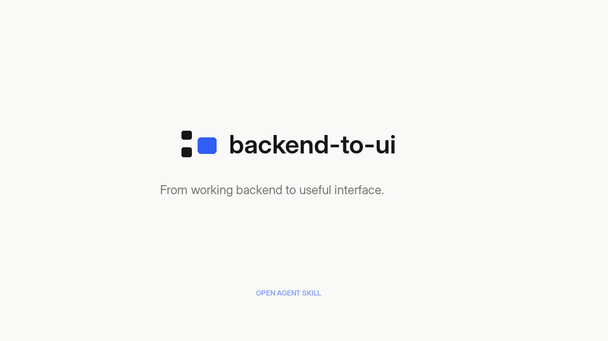

# backend-to-ui

**Your backend already knows what the app can do. Build the interface people need.**

[](media/intro.mp4)

[Watch the 28-second introduction](media/intro.mp4) · [Explore the skill](skills/backend-to-ui/SKILL.md)

`backend-to-ui` is an open [Agent Skill](https://agentskills.io/specification) for turning an existing backend into a useful, well-designed frontend. It reads the code you have, understands the product context, maps actual contracts to user tasks, and implements and tests the result. It is not a template, UI kit, or replacement frontend framework.

**One prompt, when your coding agent has access to the repository:**

> Use backend-to-ui to build the frontend for this backend.

## Install

Requires a supported coding agent and Node.js 22.20+ for the [`skills` CLI](https://skills.sh/docs/cli). Run in your project:

```bash
npx skills add alifakbxr/backend-to-ui --skill backend-to-ui
```

Choose your agent and install scope in the prompts. To install globally across your coding projects:

```bash
npx skills add alifakbxr/backend-to-ui --skill backend-to-ui -g
```

**Publication status:** These commands become usable once `alifakbxr/backend-to-ui` has been created as a public GitHub repository. Until then, test from this local repository with `npx skills add . --list` or install from the local folder. If the GitHub owner changes, replace `alifakbxr` in these commands.

Compatible Agent Skills hosts include Claude Code, Gemini CLI, Antigravity, and Codex. Host capabilities vary: the skill provides instructions, not an automatic execution environment. [Detailed installation and usage](docs/USAGE.md).

## What it does

| Understands | Implements | Verifies |
| --- | --- | --- |
| Existing stack and conventions | UI suited to the actual users | Real flows, including loading and failure |
| Routes, API contracts and page props | Data access without invented endpoints | Responsive and accessible behavior |
| Authorization and business rules | Pagination, cache boundaries, cancellation | Rendering and request performance when tools permit |
| Existing product identity | Forms and mutations only if the backend supports them | Clear, evidence-based delivery notes |

It adapts to REST, GraphQL, RPC/gRPC, Inertia, SSR, server templates, SPA, native, and realtime patterns where supported by the project. **No automatic rewrite to React or any other stack.**

## How it works

**Backend discovery → user-task mapping → context-based art direction → implementation → performance and visual QA.**

The skill is designed for a one-shot *request*, not one-shot guesswork. A coding agent must still inspect the repository and run the checks its environment actually supports. It should not invent features, silently bypass authorization, or report measurements it did not take.

See [the workflow and its safeguards](docs/WORKFLOW.md) and the [source instructions](skills/backend-to-ui/SKILL.md).

## Example

Suppose the repository already exposes a paginated orders endpoint and an authorized update operation. The agent should create a purposeful orders workflow, with server-backed filters, usable detail views and guarded updates—not download every order into the browser and render an arbitrary analytics dashboard. These endpoint examples are **illustrative**, not APIs provided by this skill.

Want to give the agent context without writing a long brief?

> Use backend-to-ui. This is a mobile-first app for warehouse staff. Keep the existing auth, branding, and business logic. Build the primary workflows and test on a narrow screen.

See [practical prompts and troubleshooting](docs/USAGE.md).

## Demo

The cover above links to an MP4 introduction included in this repository. **The video is a motion concept, not a recording of a live API-backed product.**

To display a native inline GitHub video player, upload `media/intro.mp4` through GitHub's Markdown editor and place the actual `github.com/user-attachments/assets/...` URL on its own line. GitHub handles that asset as an embedded player; the linked cover above remains a reliable fallback on other Markdown renderers. [Publishing instructions](docs/PUBLISHING.md#show-the-video-inline-on-github).

## Project structure

```text
skills/backend-to-ui/
├── SKILL.md                  # Small entry point loaded by the agent
└── references/              # Read only when relevant
    ├── data.md
    ├── design.md
    ├── performance.md
    ├── stacks.md
    └── verify.md
media/                         # Public-facing cover + intro, not used by the skill
docs/                          # Installation, workflow, release and publishing guides
tests/                         # Dependency-free structure checks
```

The actual skill is just `skills/backend-to-ui/`. No installer scripts, additional APIs, analytics services or credentials are required to use its instructions.

## Quality and trust

Run the repository checks:

```bash
python3 tests/validate.py
```

CI runs the same structural checks on pull requests. These verify metadata, references, docs and media existence—not the quality of every future frontend. End-to-end UI performance and visual quality must be checked on the **target project**, with its own tests and data.

- [Security and trust model](SECURITY.md)
- [Contributing](CONTRIBUTING.md)
- [Changelog](CHANGELOG.md)
- [How to publish on skills.sh](docs/PUBLISHING.md)

## License and acknowledgment

MIT © backend-to-ui contributors. Inspired by the open [Agent Skills specification](https://agentskills.io/specification) and design-language documentation practices such as [VoltAgent/awesome-design-md](https://github.com/VoltAgent/awesome-design-md). No third-party design assets, proprietary interfaces or external agent binaries are included.
